# zmail

A local Linux desktop email client for Gmail that plays a custom sound for
new mail, per sender or per rule, the way Eudora did.

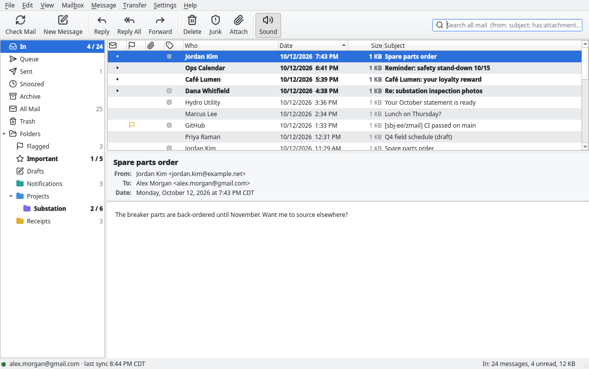

**Version 1.0.2.** Linux amd64, packaged as a `.deb`. Release history is in
[CHANGELOG.md](CHANGELOG.md) (and, before 0.9.0, on the
[Releases](https://github.com/sbj-ee/zmail/releases) page).

## Features

- **Two ways to connect Gmail:** a 16-letter app password over IMAP + SMTP (no
  Google Cloud project needed), or Google sign-in (OAuth 2.0). Secrets live
  only in the OS keyring (Secret Service / libsecret), never in a file.
- **Eudora-style mail:** In, Queue, Sent, Snoozed, Junk / Suspicious, Archive,
  All Mail and Trash, nested folders (Gmail labels) with live unread / total
  counts, Filters, coloured flags, nicknames, stationery, Send Later and Undo
  Send, and a custom new-mail sound per sender or rule.
- **Composing:** HTML, plain text or Markdown, attachments (25 MB check,
  optional zip), drafts, styled signatures and spell check.
- **Reading safely:** a strict HTML sanitizer, remote images blocked or asked
  for (HTTPS only), one-click unsubscribe, calendar invitations as a card.
- **Local cache with full-text search** and Gmail search syntax (`from:`,
  `has:attachment`, `is:unread`, …).
- **Themes** (including a Theme Editor; files shared with zterminal).
- **Signed self-update** from GitHub Releases (minisign + SHA-256).
- C++20, Qt 6 Widgets, CMake/CPack (same stack as
  [zterminal](https://github.com/sbj-ee/zterminal) and
  [zwriter](https://github.com/sbj-ee/zwriter)).

## Install

zmail is built for **Ubuntu 24.04 / Pop!_OS 24.04 (amd64)**. Each release on the
[Releases page](https://github.com/sbj-ee/zmail/releases) has three files:
`zmail_<version>_amd64.deb`, `SHA256SUMS` and `SHA256SUMS.minisig`. There is no
macOS (`.dmg`) or Windows build.

1. Download the three files into one folder, e.g. with the GitHub CLI:

   ```sh
   gh release download v1.0.2 --repo sbj-ee/zmail
   ```

2. Check the signature on `SHA256SUMS` with zmail's release key
   (ID `DBC46B23C3AF0EF3`; `sudo apt install minisign` if you don't have it):

   ```sh
   minisign -Vm SHA256SUMS -P RWTzDq/DI2vE2xMeF01QWTxP2lwwlxGL9M1UxQE4EFV5kVmTF84wwyi2
   ```

   It must say `Signature and comment signature verified` and name key ID
   `DBC46B23C3AF0EF3`. Stop if it doesn't.

3. Check the package against the signed checksums:

   ```sh
   sha256sum -c SHA256SUMS
   ```

4. Install it (apt pulls in the Qt 6 libraries it needs):

   ```sh
   sudo apt install ./zmail_1.0.2_amd64.deb
   ```

Start **zmail** from the app menu, then connect your account (below). Later
versions arrive through the [in-app updater](#updates), which does steps 2–4 for
you.

## Quick start: Gmail with an app password

1. Turn on 2-Step Verification for your Google account.
2. Create an app password named `zmail` at
   [myaccount.google.com/apppasswords](https://myaccount.google.com/apppasswords).
3. In zmail's **Connect your Gmail** dialog choose **Use a Gmail app password
   instead…**, enter your address and the 16 letters, click **Test**, then
   **Save**.

Details, limits and the OAuth alternative are in the next section.

## Connect your Gmail

zmail uses **your own** Google OAuth client, so nothing goes through a
third-party server. One-time setup (about 5 minutes):

1. Open [Google Cloud Console](https://console.cloud.google.com/) and create
   (or pick) a project, e.g. `zmail`.
2. **APIs & Services → Library**: search for **Gmail API** and click **Enable**.
3. Open [Google Auth Platform](https://console.cloud.google.com/auth/overview)
   and click **Get started**: app name `zmail`, your email as the support and
   contact address.
4. **Audience**: user type **External**. Click **Publish app** so the status
   is **In production**. It stays *unverified*; that's fine for your own
   account. (Google shows a warning at sign-in, and refresh tokens don't
   expire after 7 days the way they do in Testing.)
5. **Clients → Create client**: application type **Desktop app**, name
   `zmail`, **Create**, then **Download JSON** in the "OAuth client created"
   box right away (Google may not show the secret again). It saves
   `client_secret_….apps.googleusercontent.com.json` to `~/Downloads`.
6. Start `zmail`. The **Connect your Gmail** dialog opens. Click
   **Choose client file…** and pick that file. zmail copies it to
   `~/.config/zmail/oauth-client.json` with mode 0600. (Or do it by hand:
   `install -D -m 600 ~/Downloads/client_secret_*.json ~/.config/zmail/oauth-client.json`.)
   zmail won't sign in while that file is readable by other users; the
   dialog offers **Fix (chmod 600)**.
7. Click **Sign in with Google**. Your browser opens Google's sign-in page.
   Pick your account. On **"Google hasn't verified this app"** click
   **Advanced → Go to zmail (unsafe)**. Tick the box that lets zmail
   **read, compose, and send email**, then **Continue**. The browser tab says
   *zmail is signed in*; switch back to zmail.

zmail asks only for `gmail.modify` plus `openid email` (to show which account
signed in). The refresh token goes to your system keyring (GNOME Keyring /
KWallet via QtKeychain), never to a file; the access token stays in memory.
The mail cache lives in `~/.local/share/zmail/<account>/zmail.db` (mode 0600,
directory 0700). **File → Sign Out** forgets the token and revokes it at Google.
If Google ever rejects the saved sign-in (revoked, password changed), zmail
shows the sign-in dialog again.

### Or: connect with an app password (IMAP + SMTP)

No Google Cloud project needed. zmail talks to Gmail over IMAP
(`imap.gmail.com:993`) and SMTP (`smtp.gmail.com:465`), signing in with a
16-letter **app password**. You don't hit the 7-day token expiry that OAuth
clients get while their app is in "Testing".

1. Turn on **2-Step Verification** for your Google account. App passwords
   need it.
2. Make an app password at
   [myaccount.google.com/apppasswords](https://myaccount.google.com/apppasswords)
   (Google's help: [Sign in with app passwords](https://support.google.com/accounts/answer/185833)).
   Name it `zmail` and copy the 16 letters.
3. In zmail's **Connect your Gmail** dialog, click **Use a Gmail app
   password instead…**. Enter your name (optional; it's shown in From), your Gmail
   address and the app password, then click **Test** and **Save**.

The app password goes only to your system keyring (QtKeychain). There's no
plaintext fallback, and zmail never logs it. **File → Sign Out** removes it
from the keyring. To stop zmail's access altogether, revoke the app password
on the same Google page. If Google refuses the password (revoked, or your
Google password changed), zmail says so and **stops retrying**, because
repeated failed logins can get the account locked. Enter a new one in the
account dialog. **Settings → Your Name…** changes the From name later.

| Account dialog | App-password mailbox (fake server) | Gmail-syntax search over IMAP |
|---|---|---|
| 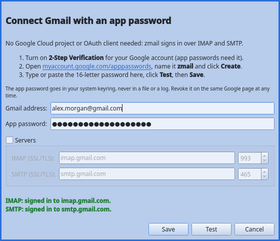 |  | 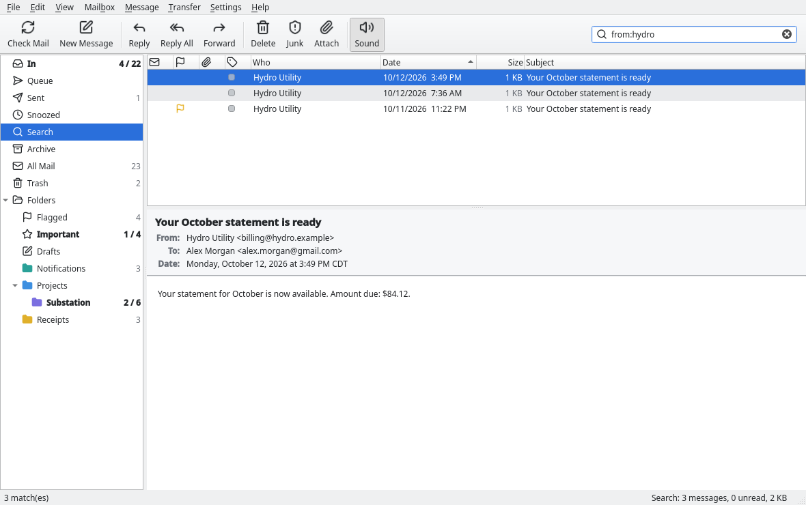 |

What works the same as with OAuth: reading, IDLE push for new mail, folders
and labels (create, rename, delete, move), archive, Trash with Undo, Junk,
flags/stars, read/unread, bulk actions, Gmail search syntax (`from:`,
`has:attachment`, … sent to Gmail as `X-GM-RAW`), attachments, sending
(including **Send Later** and **Send Queued**), drafts kept in
`[Gmail]/Drafts`, and snooze.

**Limitations of app-password accounts:**

- **No vacation responder.** Gmail's auto-reply is only reachable through the
  Gmail API. Set it in Gmail on the web (Settings → General → Vacation
  responder). **Settings → Vacation Responder** in zmail says so.
- **No folder colours.** IMAP folders have none. Colours set in Gmail on the
  web aren't shown.
- **Snooze is local to zmail**, as it is with OAuth: the message leaves the
  Inbox and comes back at the chosen time *while zmail is running*. The
  Gmail web and phone apps don't show it as snoozed.
- **Send-as aliases aren't used.** Mail goes out from the account's own
  address, with the name you entered.
- **Gmail's limits apply.**
  - IMAP allows 15 connections per account, plus daily bandwidth caps.
  - SMTP has a daily sending limit.
  - On *too many connections*, *bandwidth / throttled*, *temporarily
    unavailable* or *try again later*, zmail backs off with jitter and tries
    again: about 1 → 15 minutes for connections, 10 → 60 minutes for
    bandwidth, and 2 s → 5 minutes for temporary errors.
  - A message that hits the daily sending limit stays in **Queue**.
- Requires 2-Step Verification. Some Workspace admins turn app passwords
  off; in that case use the OAuth setup above.

`zmail --offline` shows the built-in sample mailbox without connecting.

| First run | Sign in | Synced mailbox (mock data) |
|---|---|---|
| 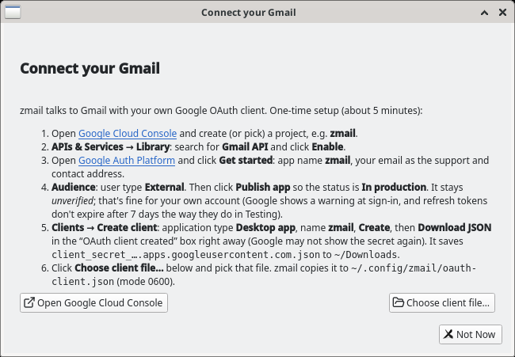 | 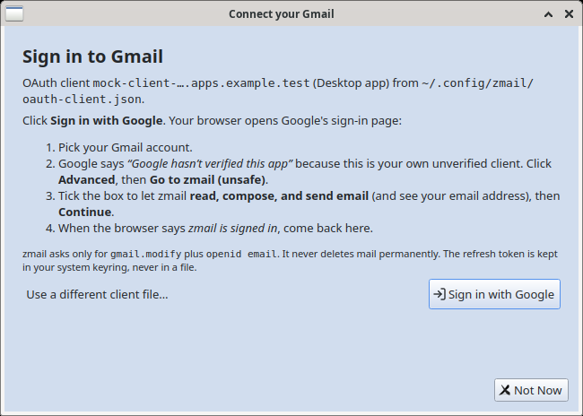 | 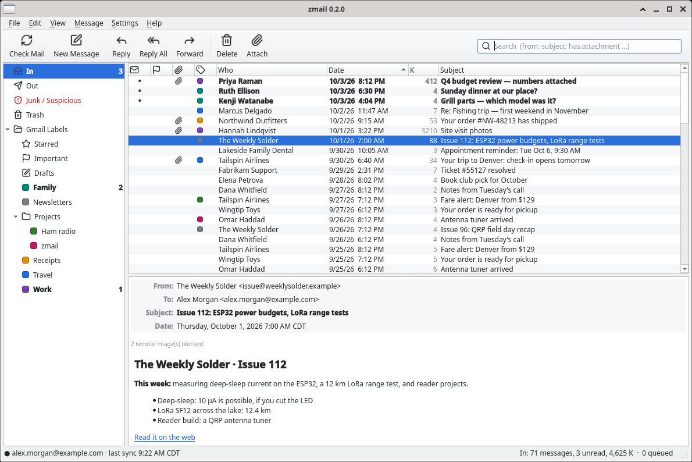 |

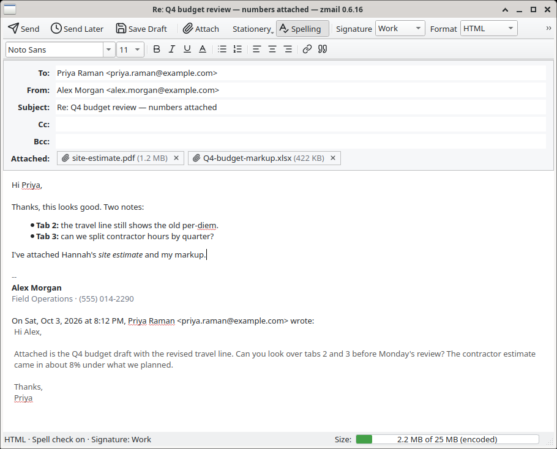

## Build

```sh
sudo apt install qt6-base-dev qt6-svg-dev qt6-multimedia-dev qtkeychain-qt6-dev \
  libqt6sql6-sqlite libmd4c-dev libmd4c-html0-dev libzip-dev libsodium-dev \
  libhunspell-dev hunspell-en-us cmake ninja-build g++ pkg-config
cmake -B build -G Ninja -DCMAKE_BUILD_TYPE=Release
cmake --build build
ctest --test-dir build --output-on-failure
cd build && cpack -G DEB   # zmail_1.0.2_amd64.deb
```

The version lives only in `project(zmail VERSION ...)` in `CMakeLists.txt`.
The tests never talk to Google: they run against an in-process mock of the
OAuth and Gmail endpoints (`tests/mock/MockGoogle`).

## Reading mail

- HTML mail is shown on a white page, laid out to the width of the pane.
  **View → Dark Background for Messages** gives a dark version. Content the
  sender hid (preheaders, dark-mode duplicates) stays hidden, and 600 px
  newsletter cards are centred as in Gmail.
- Remote images: **Settings → Privacy → Remote images** is *Ask* (default:
  a **Load images** bar per message, with **Always for this sender**; the
  allow list is edited or cleared on the same page), *Always load* or
  *Never*. Image requests never carry cookies or credentials, are
  size-capped, use HTTPS only and only go to public addresses (never
  localhost, the LAN or a tailnet), and known tracking pixels (1×1 images,
  read-receipt services) are dropped even in *Always*, unless you untick
  **Block tracking pixels**.
- Emoji in subjects and messages use Noto Color Emoji when it's installed
  (`fonts-noto-color-emoji`, recommended by the .deb).
- A message whose layout would stall the window (very wide or deeply nested
  tables) is shown simplified, with a **Show full layout** button for when
  you want it as sent and don't mind the wait.
- Ctrl+= and Ctrl+- (or Ctrl+wheel) zoom the message; Ctrl+0 resets it.
- **View → Preview Pane** shows the preview below the list or to its right;
  by default the message gets about two thirds of the space. Drag the divider to resize it; zmail remembers the layout.
- Double-click a message (or press Ctrl+O) to open it in its own window.
- Labels are folders, and a message is in one folder at a time: dragging it
  onto a label removes it from In and from any other label it had; dragging
  it onto **In** moves it back.
  Deleting a message takes it out of its folder too (Undo Delete puts it
  back). A folder loads more of its mail by itself when the list is too
  short to scroll.
  Right-click a folder for **Empty Folder** (all its mail to Trash) or
  **Delete Folder** (the label only; its mail is kept).
- **Filters** (Settings → Filters), as in Eudora: an ordered list of rules,
  and the first one that matches a message applies. A rule matches on From,
  To or Subject (contains, is, starts or ends with, a regular expression;
  all or any of its conditions) and can colour the message's row, flag it,
  move it to a folder, mark it read, and play its own sound or none when it
  arrives. Colours show on every matching message; the rest happens when
  mail arrives, or on **Message → Filter Messages** (Ctrl+Alt+J) for the
  selection. Right-click a message → **Make Filter** starts one from its
  sender. Rules are kept in `rules.json` in zmail's config folder.
- Eudora's **Mailbox** and **Transfer** menus list your mailboxes and
  folders: Mailbox goes to one (Ctrl+1 for In, Ctrl+2 for Sent), Transfer
  moves the selected messages to one, also from the right-click menu.
  Eudora's keys work: Ctrl+D delete, Ctrl+E send, Ctrl+T send queued,
  Ctrl+Alt+J filter, Ctrl+K add the sender to Contacts, Ctrl+L Contacts,
  Ctrl+H attach, Ctrl+M check mail.
- The sidebar's counts are live. Each mailbox shows **unread / total**
  (`3 / 212`, in bold while something is unread; just the total otherwise),
  and the numbers move as you delete, read or move mail, without waiting
  for Gmail. Mail and changes made elsewhere show within about 15 seconds.
- **Archive** has a row of its own above Trash. Right-click a message and
  choose Archive (or Message → Archive, or drag it there) to move it out of
  the Inbox. It is an ordinary folder, made the first time you archive
  something: a Gmail label called "Archived" (Gmail keeps the name
  "Archive" for itself).
- **All Mail**, below Archive, lists every message in Gmail except Trash
  and Spam, whether or not it is in the Inbox or a folder, so mail that is
  in neither can still be found. It loads as you scroll (or with Load All
  Messages). Its count is every message in the account outside Trash and Spam.
- Every folder in the sidebar is a folder icon in its own colour: the
  label's Gmail colour if it has one, otherwise one picked from its name.
- Moving a message into a folder also takes it out of Gmail's **Important**
  (which Gmail assigns by itself); Undo puts it back. **Mailbox → Clear
  Important from Filed Mail** does the same, once, for everything already
  in a folder.
- The mailbox for sent mail is called **Sent** (it was Out). Mail that
  hasn't gone yet is in **Queue**, just above it, not mixed in with what
  was sent.
- **Mailbox → Load All Messages** (or right-click a mailbox) fetches every
  message in it, not only the ones scrolled to so far, with progress in the
  status bar and Stop Loading to interrupt. Deleting a large selection goes
  to Gmail in batches of a thousand.
- A mailbox can open in **a window of its own**, as in Eudora (right-click
  it → Open in New Window, or Mailbox → Open in New Window, Ctrl+Shift+N):
  the same live list with its own preview pane, so two mailboxes can be seen
  side by side. Double-click opens a message, Delete deletes, right-click has
  the full set of commands, and messages can be dragged from it onto a folder
  in the main window.
- **Stationery**, as in Eudora: messages kept as templates (Settings →
  Stationery, or **Save This Message as Stationery** from the compose
  window's Stationery button). **File → New Message With** starts a message
  from one and **Message → Reply With** answers with one: its text goes
  above your signature and the quoted original, and its recipients and
  subject are used where the message has none.
- **Send** waits two minutes before the message goes: it sits in **Queue**
  until then, and **Edit → Undo Send** (Ctrl+Z, or Undo in the status bar)
  takes it back, open again and unsent. **Settings → Send Delay** sets how
  long (at once, 30 seconds, 1, 2 or 5 minutes). zmail has to be running
  for it to go; one still waiting when zmail quits goes the next time it
  starts.
- **Send Later** in the compose window (Ctrl+Shift+Enter) asks when: at a
  date and time you pick, or held, as in Eudora, until you choose **File →
  Send Queued Messages**. Either way the message waits in **Queue**, the
  mailbox above Sent, marked Q; its count is how many are waiting. A
  timed one goes at its time if zmail is running, and otherwise the next
  time zmail starts. **File → Send Queued Messages** (Ctrl+T) sends
  everything waiting, timed or not, oldest first; one that Gmail refuses stays queued with the reason. Delete
  takes a queued message out of the queue. The queue is kept on this
  computer until it is sent.
- **Flags** come in seven colours. Click a message's flag column to flag it
  (in the colour used last) or clear it; right-click, or **Message → Flag**,
  to pick a colour, for one message or several. Any flag also stars the
  message in Gmail; the colour is zmail's own. Mail starred elsewhere shows
  a yellow flag.
- Dragging a message over the sidebar lights the folder it would go to.
- Right-click a message to add its sender to Contacts (offered when that
  address isn't a contact yet).
- Right-click **Trash → Empty Trash** removes everything in it from zmail.
  Gmail does not let a mail client with zmail's permission erase mail, so
  Gmail keeps those messages in its own Trash until it purges them.
- Right-click **Junk / Suspicious → Empty Junk…** moves every message in
  Spam to Trash, the same as Delete does anywhere else in zmail (nothing is
  erased permanently; Gmail empties Trash itself after 30 days). zmail asks
  Gmail how many messages Spam holds right now and shows that in the
  confirmation (Cancel is the default button; if Gmail can't be asked it says
  the number is only zmail's last count). The mail moves in batches of 200,
  one batch at a time, so a big Spam folder doesn't block the window or trip
  Gmail's limits: the Gmail API account goes through the same quota bucket and
  429 backoff as the rest of zmail, and an app-password (IMAP) account hangs up
  and waits out Gmail's throttle like every other IMAP command. The status bar
  shows "Emptying Junk: N of M" with a **Stop** button (the right-click menu
  says **Stop Emptying Junk** meanwhile); what has moved stays in Trash. If
  Gmail refuses part of it, a message says how many moved and why it stopped.
- Shift+click and Shift+arrows select a range from the current message, up
  or down.
- **Settings → Contacts** is zmail's own address book, kept on this
  computer (`contacts.db`); zmail doesn't sync with Google Contacts. Select
  one to read it; **Edit** (or a double-click) opens it in a window of its
  own to change its name, addresses, nickname, categories (a contact can be
  in several), your own fields (Phone, Company, anything), comment, and
  whether it is hidden. Contacts an older zmail copied from Google Contacts
  stay and work like the rest; **Use Original** undoes edits to their name
  and addresses. **New Contact** adds one; **Delete** removes any contact. Hidden contacts leave the list and are not suggested when you write
  a message. All of this stays on your computer; nothing is read from or written to Google.
  **Export** saves the contacts shown, or all of them, as a JSON file with
  their categories, fields and comments.
- **Nicknames**, as in Eudora: give a contact a nickname (Settings →
  Contacts) and type it in To, Cc or Bcc instead of the address. A
  category's name is a nickname for everyone in it. zmail suggests them as
  you type and writes the addresses out when you leave the field.
- **Settings → Settings…** (Ctrl+,) is one window with a section each for
  Filters, Signatures, Stationery, Message List, Row Stripes, Sounds and
  Privacy, and one OK and Cancel for all of them.
- **Undo** (Ctrl+Z, or the bar in the status bar) takes back a Delete, a
  move to a folder, Empty Folder and Empty Trash for a few seconds.
- A queued message opens in the compose window again when you double-click
  it, to change it before it goes.
- When mail arrives and zmail isn't in front you get a desktop notification
  (**View → Notify for New Mail**), and the window title shows the Inbox's
  unread count.
- Right-clicking a mailbox in the sidebar acts on that mailbox without
  leaving the one you are in; with no mouse attached, Ctrl+click opens the
  same menu. Empty mailboxes and an empty preview say so.
- Dialogs (Contacts, Settings, message boxes) are tinted with the theme's
  selection colour, lists and fields included, and have a frame in that
  colour, so one lying over the main window stands out from it.
- An unread message is marked read once it has been on show for 10
  seconds, in the preview or in a window of its own, so arrowing past new
  mail, or a glance at it, leaves it unread. **View → Mark Messages as
  Read** changes that: immediately, after 3, 10 or 30 seconds, or only when
  you mark them yourself.
- Mail from a mailing list that says how to leave it (a `List-Unsubscribe`
  header) gets an **Unsubscribe** bar above the message (also **Message →
  Unsubscribe from Mailing List**). zmail asks first, then does it the way
  the list offers: a one-click request to the list's server (RFC 8058), an
  unsubscribe e-mail sent from your address, or, when the list has neither,
  its unsubscribe page in your browser. Only `https` addresses are used,
  and never for mail in Spam. The bar then says when you unsubscribed.
- A calendar invitation (a `text/calendar` part or an `.ics` file) shows as
  a card above the message: what it is (invitation, cancellation, someone's
  reply), when in your own time zone, where, who organised it and who is
  invited. zmail only displays it; it does not answer invitations.
- **Settings → Vacation Responder** turns Gmail's automatic reply on or
  off: subject, message, optional first and last day, and whether only
  people in your Contacts get it. Google sends the replies, so it works
  with zmail closed, and the status bar shows while it is on. The first
  time you save, Google asks in your browser to let zmail change Gmail
  settings.
- **Help → Keyboard Shortcuts** (Ctrl+/) lists every key.
- Search understands `is:flagged` and `flag:red` (or any flag colour).
- Dates in the message list read `01/01/2026  9:05 AM`.
- **File → Save Attachments** saves the open message's attachments into a
  folder you choose (safe file names, never over an existing file), and
  **File → Print** (Ctrl+P) prints the message with its header.
- **Edit → Copy** (Ctrl+C) copies the text selected in the message, or the
  selected messages a line each. **View → View as Plain Text** shows a
  message's text part instead of its HTML.
- **Settings → Message List** sets the message list's text size and the
  space between its rows (Compact / Comfortable / Roomy presets, or any value).
- **Settings → Row Stripes** sets how strongly alternate rows in the message
  list are shaded (a slider with Off / Subtle / Normal / Strong presets).

## Themes

**View → Theme** offers Light (default), Dark, Follow System and three brand
themes: **Boilermakers** (Purdue gold on black), **Badgers** (white on UW black
with a Badger Red toolbar and headers) and **Packers** (white on Packers green
with gold headers and selection). zmail remembers the choice (`ui/theme`);
`zmail --theme packers` overrides it for one run. Messages keep their white
page in every theme. The brand palette is shared with
[zterminal](https://github.com/sbj-ee/zterminal); see
[docs/THEMES.md](docs/THEMES.md) for every role, hex value, source and
contrast ratio.

**View → Theme → Theme Editor…** makes custom themes: duplicate any theme
(the brand ones too), pick a colour for each palette role, optionally a UI font
and size and the list's row stripes, with a live preview; then save, rename,
delete, apply, import or export. Custom themes appear in View → Theme and are
`*.ztheme.json` files in `~/.config/zmail/themes/`, a format shared with
zterminal ([docs/THEMES.md](docs/THEMES.md#theme-files-custom-themes)); zterminal's themes in
`~/.config/zterminal/themes/` are listed read-only.

| Boilermakers | Badgers | Packers |
|---|---|---|
| 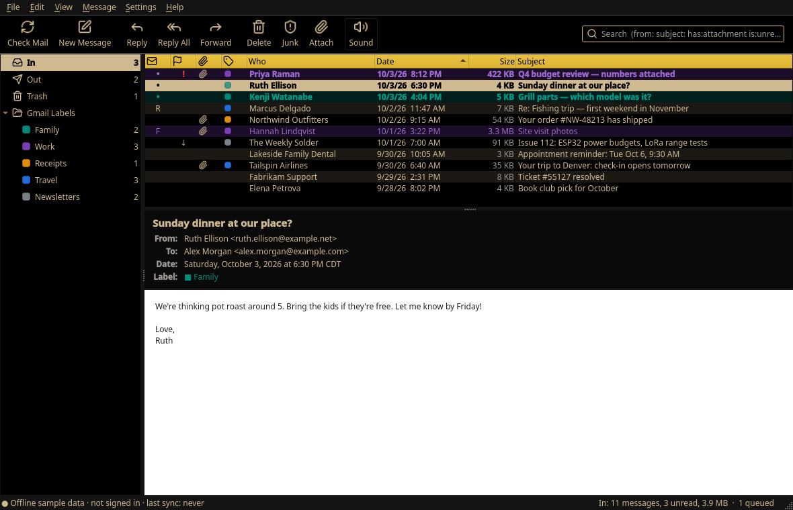 | 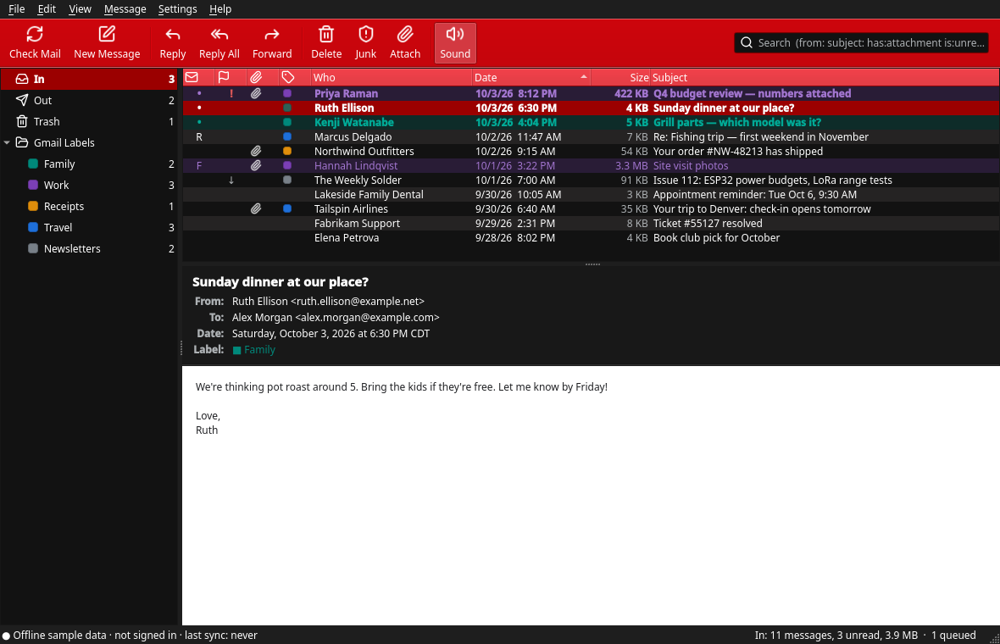 | 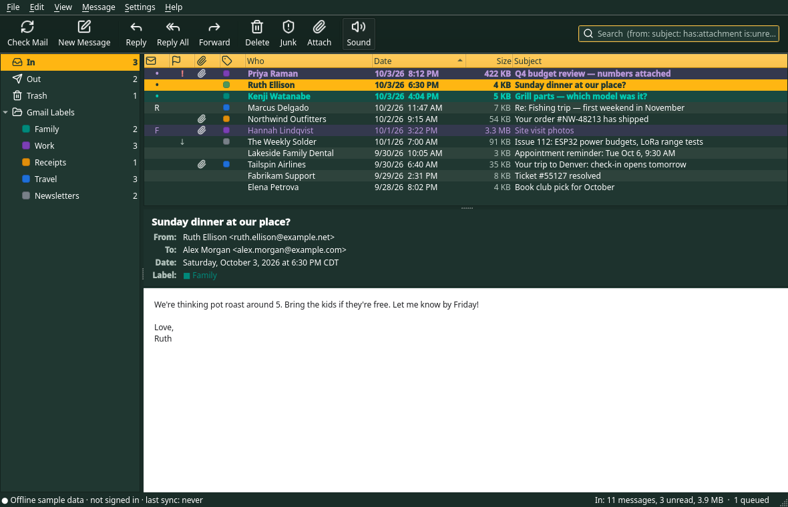 |

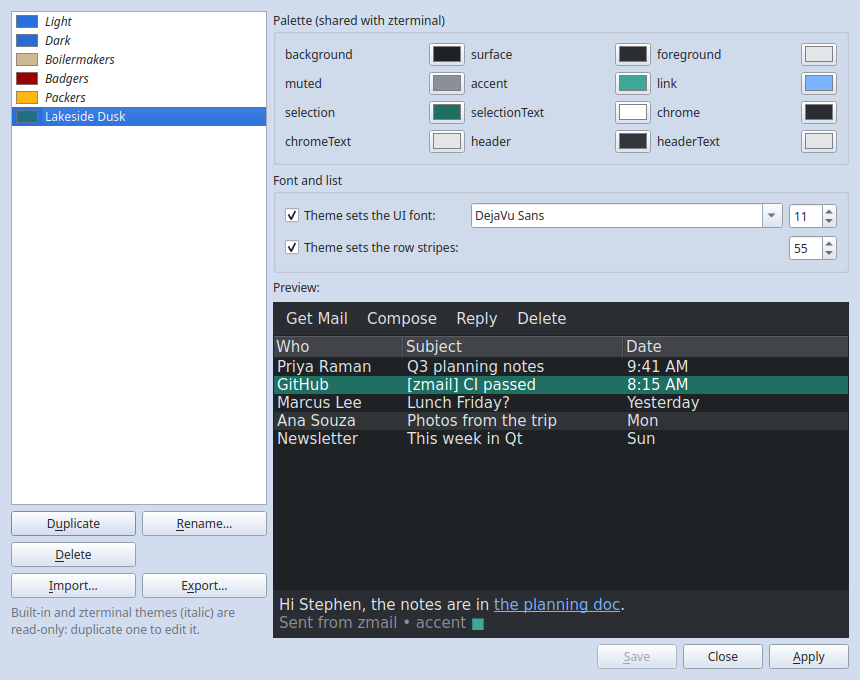

### Shared with zterminal

The themes work the same way in both apps. Boilermakers, Badgers and Packers
are built into zmail and [zterminal](https://github.com/sbj-ee/zterminal) with
the same palette, and custom themes move between them as `*.ztheme.json`
files: **Export…** in one app's Theme Editor writes `<name>.ztheme.json`, and
**Import…** in the other app's editor copies it into that app's themes folder.
If both apps run under the same user, each one also lists the other's custom
themes read-only without importing. zmail keeps but ignores a theme's terminal
colours; zterminal derives terminal colours for a theme made in zmail. The
format, the file locations and how missing colours are filled in are in
[docs/THEMES.md](docs/THEMES.md).

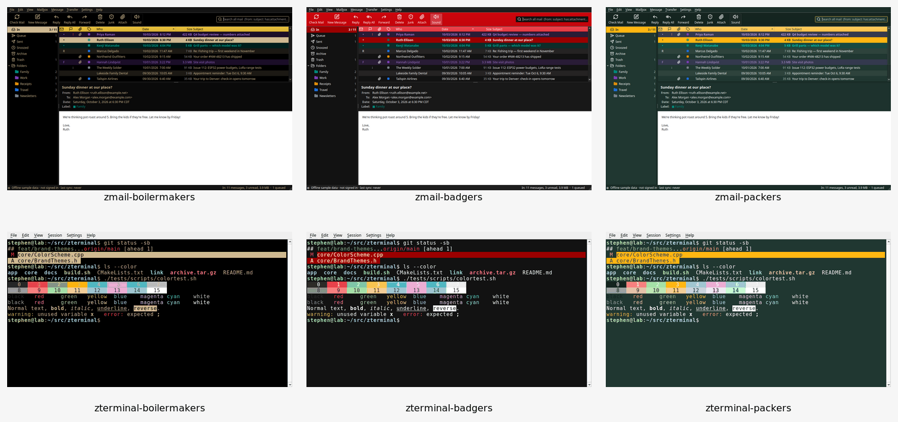

## New-mail sound

When new INBOX mail arrives (while zmail is already running), zmail plays a
short built-in two-note chime once per sync batch. Mute it from **View → Play
Sound for New Mail**, the toolbar speaker, or **Ctrl+Shift+M**. **Settings →
Sounds** turns the chime on or off, offers six more sounds that come with
zmail (Bell, Marimba, Glass, Knock, Water Drop, Harp: all original and
CC0, made by `tools/make-new-mail-sounds.py`; a filter can use one too),
lets you **Browse…** for a custom `.wav`,
**Default** resets to the bundled sound, and **Test** previews the current
choice. A missing or unreadable custom file falls back to the built-in chime
(`assets/sounds/new-mail.wav`, also embedded in the binary via Qt resources).

A message that leaves (Send, or File → Send Queued Messages) plays a short
"swoosh" (`assets/sounds/sent.wav`). **Settings → Sounds → Sent mail** turns
it off, and has its own **Test**.

## Updates

**Help → Check for Updates…** asks GitHub for the latest release. If it is newer
than the version you are running, a dialog shows its version and release notes
with **Install**, **Later** and **Skip This Version**. **Help → Check for Updates
at Startup** (on by default) does the same quietly about once a day, a few
seconds after zmail starts; it only speaks up when there is something newer, and
never while you are on `--demo`.

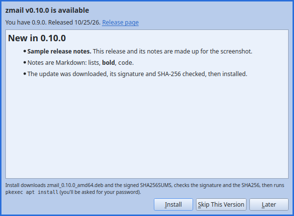

Install is the same flow zterminal has:

1. Download `SHA256SUMS` and `SHA256SUMS.minisig`, and **check the signature**
   with the minisign public key built into zmail
   (`src/core/UpdateSigningKey.cpp`). Nothing else is downloaded if it is wrong.
2. Download `zmail_<version>_amd64.deb` and check its SHA-256 against the signed
   `SHA256SUMS`.
3. Copy the package into a private (0700) folder, re-check the SHA-256, and run
   `/usr/bin/pkexec /usr/bin/apt install -y <that .deb>`. The system's own
   password prompt appears (polkit); zmail never sees the password and you do
   not have to open a terminal.
4. Offer **Restart Now / Later**. Restart closes the window the way File → Quit
   does, so a message still being written asks "Save draft?" first, then zmail
   starts again.

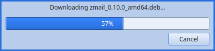
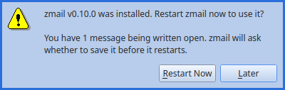

Safety rules, none of which can be turned off:

- An update is installed only if `SHA256SUMS` carries a valid
  `SHA256SUMS.minisig` from the release key and the package matches it. A release
  without a signature, with a bad one, or without the `.deb` is offered only as a
  link to its release page.
- Only a zmail installed from the `.deb` (`/usr/bin/zmail`) is replaced; a
  build-tree or `/usr/local` copy is not touched (the dialog says so, and the
  verified package stays on disk with the `sudo apt install` command).
- If `pkexec`/`apt` fail or the password prompt is dismissed, nothing is
  half-installed: zmail keeps the verified `.deb`, shows the command, and opens
  the release page.
- The update flow reads and writes no mail, tokens or settings other than its own
  last-check time and skipped version (`~/.config/zmail/update-state.ini`) and the
  startup-check switch (`updates/checkOnStartup`).
- This is a Linux amd64 feature: there is no macOS or Windows build of zmail, so on
  any other platform Install is unavailable and the dialog links to the release
  page.

Releases are signed with zmail's own minisign key, ID `DBC46B23C3AF0EF3` (public
key below). They are built, signed and published by `.github/workflows/release.yml`; see
[docs/RELEASING.md](docs/RELEASING.md) (the signing key and the two repository
secrets it needs). To check a release by hand:

```sh
minisign -Vm SHA256SUMS -P RWTzDq/DI2vE2xMeF01QWTxP2lwwlxGL9M1UxQE4EFV5kVmTF84wwyi2
```

(Key ID `DBC46B23C3AF0EF3`; `minisign -Vm` prints it for a good signature.)

## License

MIT. See [LICENSE](LICENSE).
